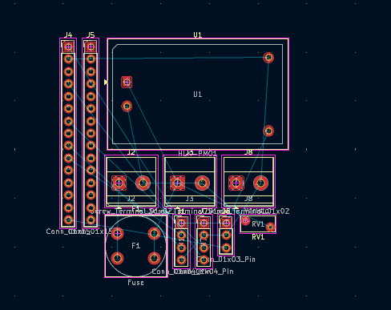
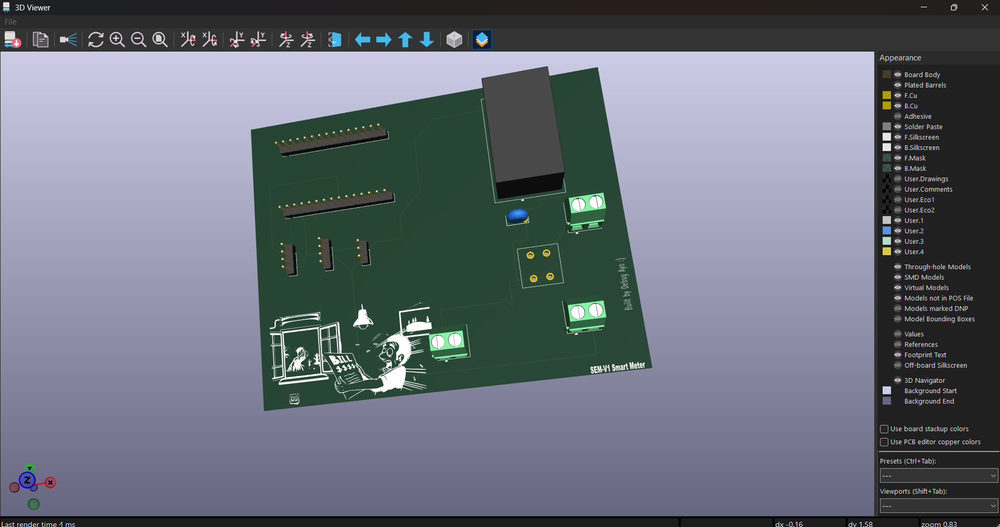
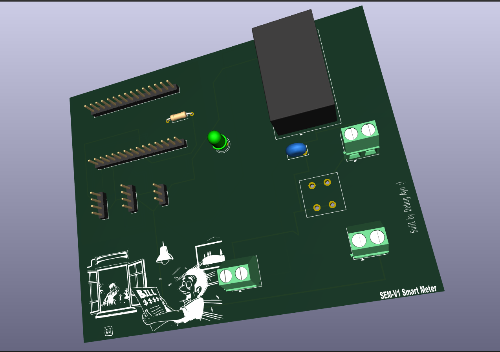

# October 19: Schematic design, ERC debugging, and footprint hunts

Spent a wild amount of time wiring up the AC mains input, HLK-PM01 power supply, and PZEM sensor module in KiCad. Ran into the classic KiCad ERC power flag warnings because it didn't trust my live feed, but figured out how to drop `PWR_FLAG` symbols to get a clean bill of health. Also had to swap out a few messy footprints so everything matches physical components. 

**Total time spent: 3.5 hours**

# October 20: PCB layout, board boundaries, and component placement

Moved over to the PCB editor today with the camera rolling for a build timelapse. Organized the board so the high-voltage AC mains stay strictly separated from the low-voltage DC logic zone for safety. Placed the screw terminals, fuse holder, and ESP32 headers so the ratlines cross as little as possible. Next up is routing those traces!

**Total time spent: 2.5 hours**

# October 22: Routing, ground pour, custom silkscreen, and Gerber export

Finished routing all the AC and DC traces today, keeping power tracks thick and pouring the ground plane on the DC section while leaving the AC side completely isolated. I Ran DRC and passed with a clean 0-error bill of health. 
Added my custom signature ("Built by Debug Ayo :)") and graphic to the silkscreen, checked everything in the 3D viewer, and generated the final manufacturing files (`production/SEM-V1_gerbers.zip`). 
So i am submitting now waiting for feedback :)

**Total time spent: 4.0 hours**

# November 5: Added indicator LED, sorted LCSC links, and wrote test code

The reviewer asked for basic blink firmware and direct BOM links before approving the grant. 

Instead of just writing dummy code for nothing, I hopped back into KiCad and added a green 3mm LED and a 1k resistor onto GPIO8 so there's a visible status light on the board. Used through-hole parts here so I don't have to stress about soldering microscopic SMD pads with a normal iron. Had to nudge a few traces around the HLK-PM01 side to keep clean clearance away from the AC mains line, then exported a fresh 3D render.

Spent the rest of the time tracking down the exact LCSC part numbers, checking minimum order quantities, and figuring out DHL shipping to Nigeria so the budget request matches reality. Wrapped up by writing a no-nonsense Arduino test sketch to toggle the LED and print to serial.

**Total time spent: 4 hours**