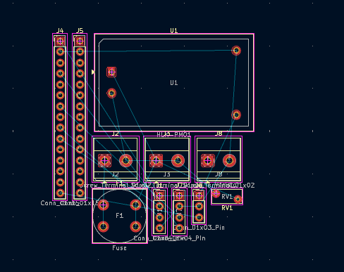
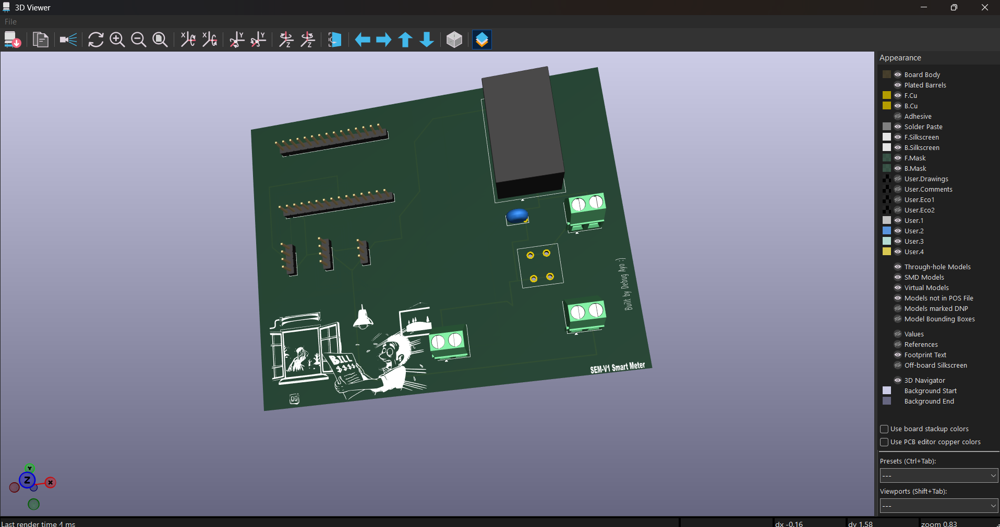

# ESP32 Smart Energy Meter & Load Controller

So, I got tired of manually toggling between grid power, generators, and inverters while completely guessing how much power everything was drawing. This project is my fix: a custom ESP32-powered smart energy meter that tracks live electrical data and handles automated safety cutoffs without blowing up.

## What This Board Does
- **Keeps things safe:** Uses an HLK-PM01 5V power supply backed up by a 1A fuse and a Metal Oxide Varistor (MOV) so voltage spikes don't fry the board.
- **Tracks the numbers:** Hooks up a PZEM-004T module with a CT clamp to measure real voltage, current, and power usage on the fly.
- **Switches heavy loads:** Uses an optoisolated 5V relay module to trigger a high-voltage AC contactor safely from low-voltage digital pins.
- **Maintains boundaries:** Designed the double-sided KiCad layout with a strict physical isolation gap keeping the spicy 220V AC mains completely away from the low-voltage DC logic.

## Stack & Hardware
- **Brain:** ESP32 DevKit V1 (plugs into carrier headers)
- **CAD & Layout:** KiCad
- **Core Parts:** HLK-PM01, PZEM-004T, 5V relay module, Phoenix screw terminals

## Bill of Materials (BOM)

| Component | Description | Quantity |
| :--- | :--- | :--- |
| **ESP32 DevKit V1** | Microcontroller development board (plugs into headers `J4`/`J5`) | 1 |
| **PZEM-004T v3.0** | AC energy monitor sensor module | 1 |
| **HLK-PM01** | Isolated 230V AC to 5V DC power supply module | 1 |
| **5V Relay Module** | Opto-isolated load control switch | 1 |
| **Screw Terminals** | 2-pin and 3-pin terminals for AC/DC wiring | 3 |
| **Fuse & Holder** | AC input overcurrent protection (`F1`) | 1 |
| **Varistor (MOV)** | Voltage surge protection (`RV1`) | 1 |

## Visuals & Design

### Schematic Capture

### PCB Layout

### 3D Board Render

## Repo Structure
- `Smart_Meter_PoC.kicad_sch` — KiCad schematic file.
- `Smart_Meter_PoC.kicad_pcb` — KiCad PCB layout file.
- `production/` — Generated Gerbers (`SEM-V1_gerbers.zip`), BOM, and position files.
- `images/` — Visual assets and screenshots.
- `JOURNAL.md` — Build log and workflow notes.