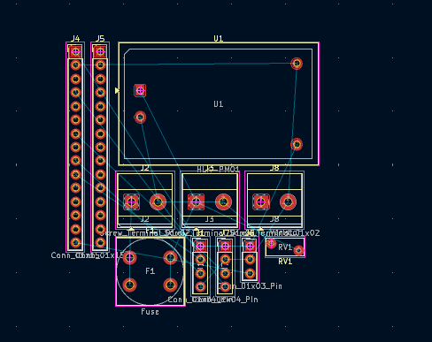
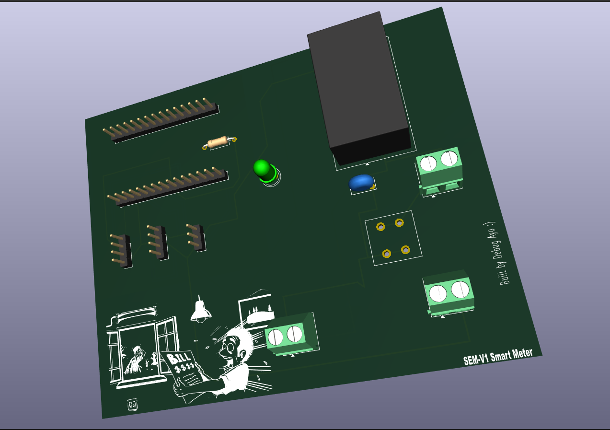

# ESP32 Smart Energy Meter & Load Controller

So, I got tired of manually toggling between grid power, generators, and inverters while completely guessing how much power everything was drawing. This project is my fix: a custom ESP32-powered smart energy meter that tracks live electrical data and handles automated safety cutoffs without blowing up.

## What This Board Does
- **Keeps things safe:** Uses an HLK-PM01 5V power supply backed up by a 1A fuse and a Metal Oxide Varistor (MOV) so voltage spikes don't fry the board.
- **Tracks the numbers:** Hooks up a PZEM-004T module with a CT clamp to measure real voltage, current, and power usage on the fly.
- **Switches heavy loads:** Uses an optoisolated 5V relay module to trigger a high-voltage AC contactor safely from low-voltage digital pins.
- **Maintains boundaries:** Designed the double-sided KiCad layout with a strict physical isolation gap keeping the spicy 220V AC mains completely away from the low-voltage DC logic.

## Stack & Hardware
- **Brain:** ESP32 DevKit V1 (plugs into carrier headers `J4`/`J5`)
- **CAD & Layout:** KiCad
- **Core Parts:** HLK-PM01, PZEM-004T, 5V relay module, Phoenix screw terminals

## Bill of Materials (BOM) & Budget

| Component | Description | LCSC Part # | Qty | Unit Price | Total Amount |
| :--- | :--- | :--- | :--- | :--- | :--- |
| **ESP32-C3 Module** | ESP32-C3-MINI-1-N4 | [C2838502](https://www.lcsc.com/product-detail/C2838502.html) | 1 | $3.0700 | $3.07 |
| **3.3V LDO Regulator** | AMS1117-3.3 (SOT-223) | [C347222](https://www.lcsc.com/product-detail/C347222.html) | 10 | $0.0491 | $0.49 |
| **USB Type-C Receptacle** | 16-Pin SMD | [C165948](https://www.lcsc.com/product-detail/C165948.html) | 5 | $0.1736 | $0.87 |
| **Tactile Push Buttons** | 3x4mm SMD | [C318884](https://www.lcsc.com/product-detail/C318884.html) | 20 | $0.0208 | $0.42 |
| **Green LED (Through-Hole)** | 3mm THT (D=3mm) | [C85161](https://www.lcsc.com/product-detail/C85161.html) | 20 | $0.0365 | $0.73 |
| **Green LED (Discrete SMD)** | 0805 SMD | [C84260](https://www.lcsc.com/product-detail/C84260.html) | 30 | $0.0223 | $0.67 |
| **Axial Resistors** | 1kΩ 1/4W Carbon Film THT | [C66649](https://www.lcsc.com/product-detail/C66649.html) | 50 | $0.0133 | $0.67 |

### Funding Request Breakdown
* **Merchandise Subtotal:** $7.02
* **LCSC Handling Fee:** $3.00
* **Merchandise Discount:** -$0.10
* **DHL Express Shipping (Nigeria):** $55.65
* **Grand Total:** $65.57

## How to Flash Firmware
To upload code to the onboard ESP32 via the Arduino IDE:
1. Connect the ESP32 board to your computer using a USB cable.
2. Select **ESP32 Dev Module** under **Tools > Board**, and choose the active COM port.
3. If the upload does not start automatically, press and hold the **BOOT** button.
4. When `Connecting.......` appears in the terminal, release the **BOOT** button.
5. Once the upload hits 100%, press the **EN / RST** button once to start the firmware.

## Visuals & Design

### Schematic Capture

### PCB Layout

### 3D Board Render

## Repo Structure
- `Smart_Meter_PoC.kicad_sch` — KiCad schematic file.
- `Smart_Meter_PoC.kicad_pcb` — KiCad PCB layout file.
- `production/` — Generated Gerbers (`SEM-V1_gerbers.zip`), BOM, and position files.
- `images/` — Visual assets and screenshots.
- `firmware/` — Microcontroller test and operational firmware.
- `JOURNAL.md` — Build log, time tracking, and workflow notes.